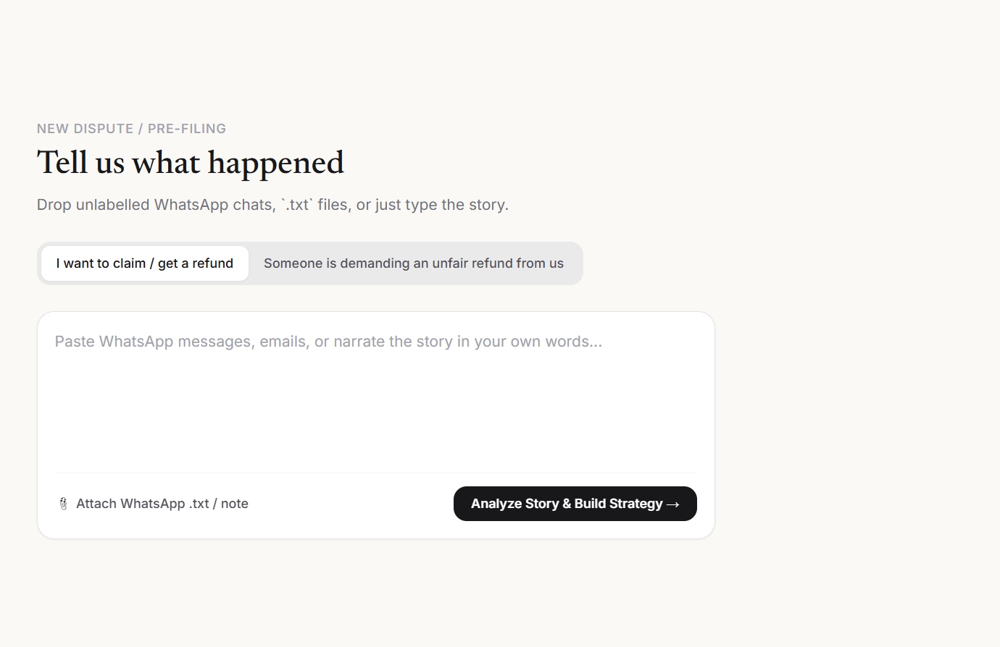
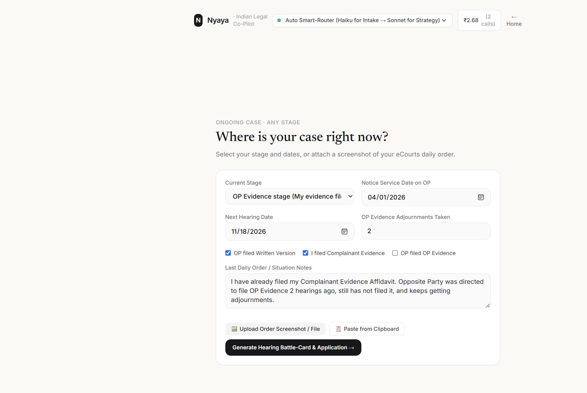
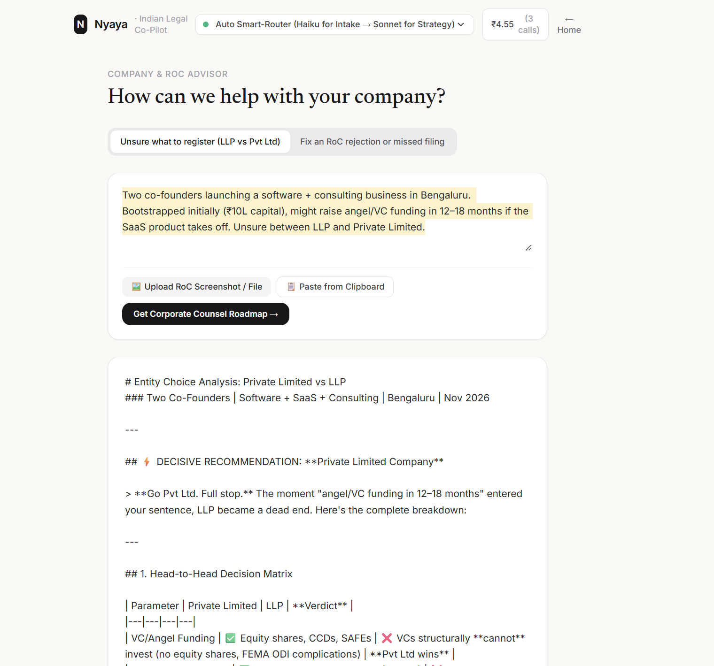
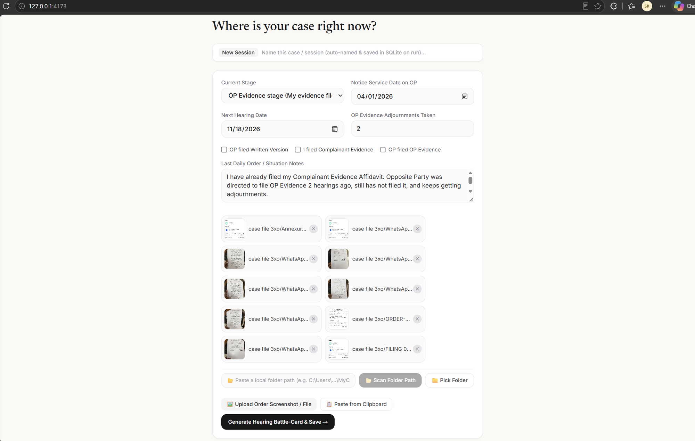
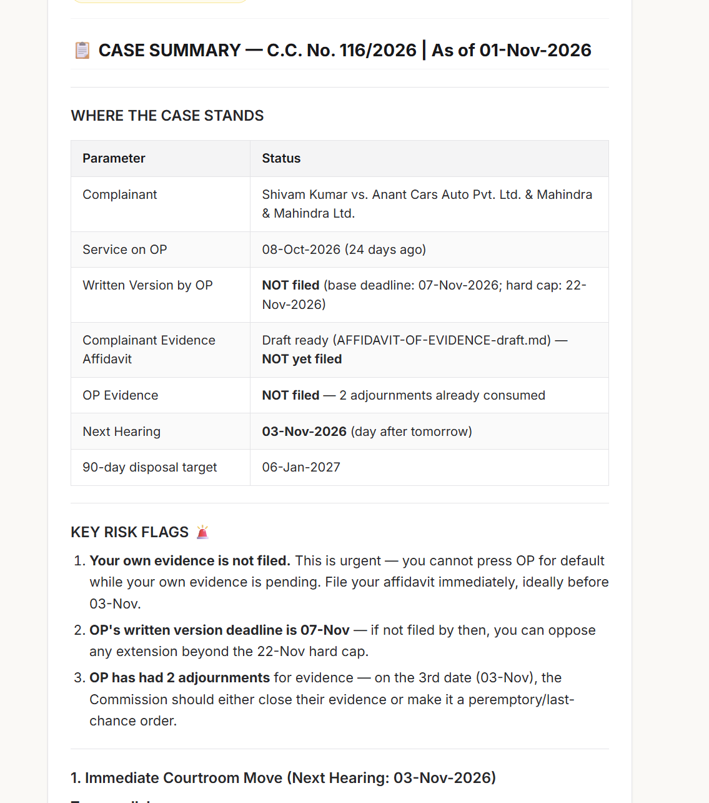
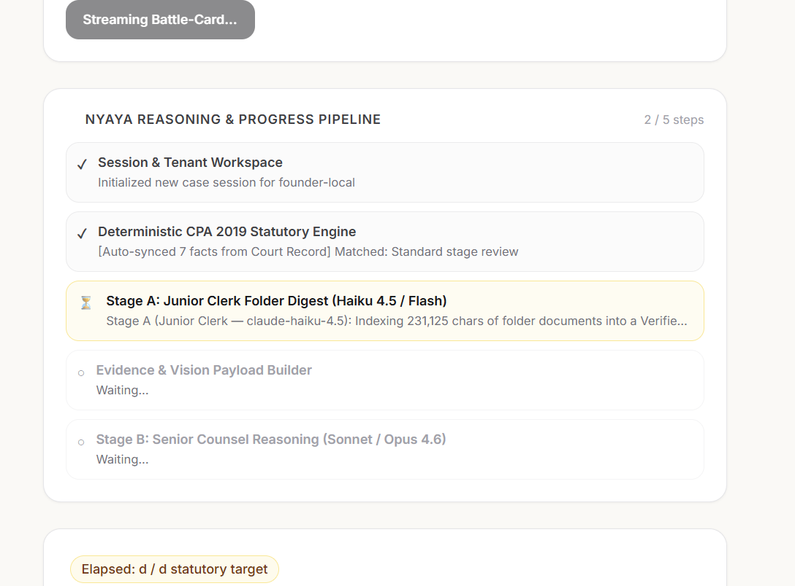

# Nyaya (Legal Co-Pilot) — Complete Engineering, AI Architecture & Cloud Deployment Guide

> **Purpose of this Document:** This step-by-step engineering & deployment playbook documents how **Nyaya — Indian Legal Co-Pilot** was designed, debugged with real case files (`C.C. No. 116/2026 — case file 3xo`), optimized for **85% lower LLM token cost without sacrificing Senior-Counsel quality**, and packaged for **zero-cost ($0/mo) and hybrid cloud deployment**.

---

## 1. Product Vision & Progressive-Disclosure UI (3 Entry Doors)

Most Indian litigants and founders get stuck not on basic essay drafting, but on **procedural tactics across the lifecycle of a real case** (e.g., an Opposite Party dragging the *OP Evidence* stage for months, a Bench reconstitution mid-case, or a client threatening an unjustified consumer complaint).

To keep the interface calm and minimal, Nyaya uses a single-column **Progressive-Disclosure UI** (`ui/index.html`) with **3 Entry Doors**:

1. **Door 1 — Start a New Dispute or Defend Against a Claim:** Drop unlabelled WhatsApp `.txt`/`.zip` exports, screenshots, or PDFs. Nyaya auto-sorts the chronology, runs the statutory viability gate (CPA 2019 s.2(10)/s.2(11)/s.2(47)), and drafts a legal notice or defence reply + BSA 2023 s.63 certificate.
2. **Door 2 — Mid-Case Tactical Coach (Any Stage):** Enter at *any* stage of the 9-stage Consumer Commission state machine (`packs/consumer/procedure.json`). Point to your local case folder or upload order sheets to get your **Immediate Courtroom Move**, **Word-for-Word Spoken Script for the Bench**, and **Ready-to-File Application/Memo**.
3. **Door 3 — Company Formation & RoC Filing Advisor:** Decisive corporate counsel (LLP vs. Private Limited vs. OPC, MCA21 v3 SPICe+ / FiLLiP forms, and RoC resubmission cures).

### Turn-by-Turn Visual Evolution (With Evidence Screenshots)

#### A. Door 1 — Clean Pre-Filing / Defence Intake (With Screenshot, PDF, DOCX & ZIP Support)


#### B. Door 2 — Mid-Case Tactical Coach & Any-Stage Onboarding


#### C. Fixing Raw Markdown Rendering → Rich Legal Typography & Tables
*Earlier iteration (bare Markdown symbols in output):*

*Fix implemented:* Integrated `marked.js` with custom `.markdown-body` legal typography, comparison tables, blockquotes, and 1-click **📄 Export Word (`.doc`)** and **🖨️ Print / Save PDF** buttons.

---

## 2. Real-World Case Folder Stress-Test (`case file 3xo` — 83 Files)

When testing with a real 83-file litigation folder (`C.C. No. 116/2026`, containing 31 PDFs in `ORDER-SHEETS/` & `FILING/`, 13 `.docx` pleadings, 30 `.md` wiki notes, and 10 screenshots):



### The "Unchecked Checkbox vs. Folder Truth" Bug (And How We Solved It)
In the first folder test, because the UI checkboxes (`OP filed Written Version` and `I filed Complainant Evidence`) were left unchecked (`false`), and because `AFFIDAVIT-OF-EVIDENCE-draft.md` appeared first alphabetically, the model falsely warned that Complainant Evidence was *"NOT yet filed"*:



### The 4-Part Engineering Fix (`src/engine/folder-case-extractor.mjs`)
1. **Native `.pdf`, `.docx`, and `.zip` Text Extraction:** Integrated `pdf-parse`, `mammoth`, and `adm-zip` so the backend reads the actual text inside `ORDER-SHEETS/*.pdf` and `FILING/*.docx` even when no `.md` files exist.
2. **"Folder Record Truth > UI Checkboxes" (`inferCaseStateFromFolder`):** Automatically scans order sheets and filings to set `writtenVersionFiled = true` (`06.07.2026`), `complainantEvidenceFiled = true` (`05.08.2026`, `Ex.P.1–Ex.P.12` marked, evidence closed), `stage = "op-evidence"`, `serviceDate = "2026-03-14"`, and `nextHearingDate = "2026-11-03"`.
3. **Multi-OP Status Matrix:** Tracks **OP-1** (`Placed EX-PARTE on 23.04.2026`) separately from **OP-2** (`Contesting; WV filed 06.07.2026; OP-2 Evidence pending`).
4. **Non-Blocking Chunked Ingestion & Offscreen Image Compression:** Yields to the browser UI thread every file and downscales 5MB phone photos to ~100KB 1100px JPEGs so the UI never freezes.

---

## 3. Production AI System Design: Cost-Efficient + Zero Compromise on Quality

To prevent re-uploading 230KB of files on every follow-up turn and avoid blind `slice(0, 28000)` truncation, Nyaya uses a **5-Layer AI Architecture**:



1. **Zero Re-Upload on Follow-Up Turns (`syncedDocNames` & `syncedImageNames`):**
   - Turn #1 uploads the folder and saves it in SQLite (`data/nyaya.db`).
   - Turn #2, #3, #4 send **only your 80-byte follow-up question** over the network unless you attach a brand-new file.
2. **Stage A — Junior Clerk + One-Time Vision OCR (`claude-haiku-4.5` / `gemini-2.5-flash`):**
   - Reads the entire folder + screenshots **once** on Turn #1 and writes a permanent **Verified Case Digest** (`sessions.folder_digest` in SQLite), including the Bench reconstitution table, chronological order-sheet table, and exhibit audit.
3. **Query-Matched BM25 Document Section Retriever (`retrieveRelevantFolderChunks`):**
   - Instead of taking a blind `slice(0, 28000)`, every turn scores all document sections against your exact question (with 3x boosting for legal identifiers like `C-13`, `Ex.P.13`, `Written Version`, `privity`, `Rejoinder`) and pulls the **Top-8 matching sections** from anywhere in the 230,000-character folder.
4. **KV-Cache-Aligned Prompt Prefix + Per-Turn Intent Classifier (`classifyTurnIntent`):**
   - Places static context (`Verified Case State + Rule Engine + Cached Case Digest`) at the very top of the prompt for **90% Prompt Cache discounts**.
   - Routes simple factual/date follow-ups (`"When was notice served?"`) to fast/balanced models (`Sonnet 4.6` / `Haiku`) and escalates strategy/drafting on complex cases to **`Claude Opus 4.6`** (plus a 1-click **`🧠 Escalate to Claude Opus 4.6`** button in the UI).
5. **Deterministic Post-Generation Fact Verifier (`verifyDraftAgainstRecord`):**
   - Audits the AI's output in `<1ms` at ₹0 cost against the verified order-sheet facts and displays **`🛡️ Record Fact-Check: PASSED`** in the UI.

---

## 4. Public Cloud Security & Multi-User Isolation (`data/nyaya.db`)

- **Strict Per-User SQLite Tenant Isolation:** Every session row in `data/nyaya.db` is keyed by `user_id` (`WHERE id = ? AND user_id = ?`), backed by an `HttpOnly` `nyaya_uid` cookie + `x-nyaya-user-id` header. User B gets `404` if they ever request User A's session ID.
- **Localhost-Only Guard on `/api/scan-folder`:** In public cloud mode, arbitrary server-path scanning is blocked (`403`); users upload folders via the browser's `📁 Pick Folder` picker.
- **Sliding-Window IP Rate Limiter & Payload Cap:** Caps public callers to 20 analyses/min per IP and 20MB max body size.
- **DPDP Act 2023 PII Scrubber (`redactPiiForCloud`):** Automatically masks 12-digit Aadhaar numbers and PAN numbers before calling external cloud LLM APIs.

---

## 5. Step-by-Step Deployment Guide (3 Zero-Cost / Low-Cost Options)

### Option A: Deploy 24/7 for ₹0 Using Your $150/Month Microsoft Employee Azure Benefit (Recommended)

1. **Activate Your Free $150/month Credit (2 mins):**
   - Go to **`https://my.visualstudio.com`** → sign in with your `@microsoft.com` account → click **Activate** on **"Azure — $150 monthly credit"** (no credit card needed; hard $0 spending limit).
2. **Create Your Azure AI Foundry Keys (`https://ai.azure.com`):**
   - Create an Azure AI Foundry hub/project under your *Visual Studio Enterprise Subscription*.
   - Deploy **`gpt-4.1`** (multimodal Vision + drafting) and **`o3-mini`** or **`DeepSeek-R1`** (reasoning).
   - Copy your `AZURE_OPENAI_ENDPOINT` and `AZURE_OPENAI_API_KEY`.
3. **Deploy the App to Azure App Service (Linux Container / Node 22):**
   ```powershell
   # Login to Azure CLI
   az login
   # Deploy directly from the legal-copilot folder to Azure App Service (Linux)
   az webapp up --name nyaya-legal-copilot --resource-group nyaya-rg --runtime "NODE:22-lts" --sku B1
   # Configure your Azure AI Foundry environment variables
   az webapp config appsettings set --name nyaya-legal-copilot --resource-group nyaya-rg --settings LLM_PROVIDER=azure-foundry AZURE_OPENAI_ENDPOINT="<your-endpoint>" AZURE_OPENAI_API_KEY="<your-key>" PUBLIC_CLOUD_MODE=true
   ```
   *Note:* On Azure App Service Linux, Nyaya automatically stores `nyaya.db` inside **`/home/data/nyaya.db`**, which Azure persists across container restarts automatically!

---

### Option B: Self-Host on Your MacBook M1 Max (64GB RAM, 2TB SSD) + Cloudflare Tunnel ($0 Forever)

Your **M1 Max with 64GB Unified Memory** can run 32B–70B legal models 100% locally for ₹0 API cost:

1. **Install Ollama & Pull Models on Your M1 Max:**
   ```bash
   brew install ollama cloudflared
   ollama serve &
   ollama pull deepseek-r1:32b
   ollama pull qwen2.5:72b
   ollama pull llama3.2-vision
   ```
2. **Start Nyaya in Ollama Mode:**
   ```bash
   git clone <your-repo-url> legal-copilot
   cd legal-copilot
   npm install
   npm run start:ollama
   ```
3. **Expose It to the Internet Safely in 1 Command (No Router Port-Forwarding):**
   ```bash
   cloudflared tunnel --url http://127.0.0.1:4173
   ```
   Cloudflare prints a live **`https://<name>.trycloudflare.com`** URL (or binds to your custom `.in` domain) that anyone can open from their phone or laptop!

---

### Option C: 1-Click Cloud Deploy on Railway.app or Render.com (~$5/month)

1. Push this repository to GitHub.
2. On **Railway.app** or **Render.com**, click **New Web Service → Connect GitHub Repo** (auto-detects `railway.json` / `render.yaml` / `Dockerfile`).
3. Attach a **Persistent Volume** mounted at `/app/data` (so `nyaya.db` persists permanently).
4. Set environment variables:
   - `LLM_PROVIDER=openrouter` (or `gemini` for Google AI Studio's 1,500 req/day Free Tier)
   - `OPENROUTER_API_KEY=<your-key>` / `GEMINI_API_KEY=<your-free-key>`
   - `PUBLIC_CLOUD_MODE=true`
